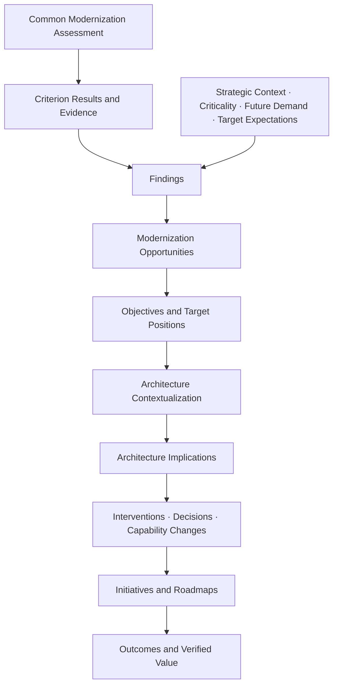
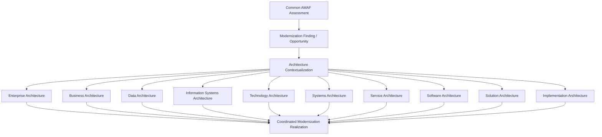

# Architecture Modernization Assessment

**A common assessment foundation for architecture modernization. Multiple architectural interpretations. Coordinated realization.**

This repository brings together two distinct but complementary assets maintained by the [Assessment-Models organisation](https://github.com/Assessment-Models):

1. **AMAF — Architecture Modernization Assessment Framework:** assesses the modernization need and opportunity of an architecture, establishes why change matters, and traces findings into architecture-specific implications and realization.
2. **Architecture Modernization Maturity Model:** assesses the organization's capability to modernize legacy estates and platforms through strategy, sequencing, execution and technical-debt reduction.

They are not two versions of the same assessment. **AMAF assesses the architecture and its modernization opportunity; the maturity model assesses the organization's modernization practice.** The maturity result can inform AMAF's D7 Adaptability & Modernization Readiness dimension as evidence, but it does not replace or numerically determine an AMAF criterion score.

---

## Find your starting point

| If you are a... | Start with |
|---|---|
| Executive, sponsor or portfolio leader | [What the assessment establishes](#what-the-assessment-establishes) and [Using assessment outputs](#using-assessment-outputs) |
| Enterprise architect or architecture leader | [AMAF architecture](#amaf-architecture-modernization-assessment-framework), [Eight dimensions](#the-eight-assessment-dimensions) and the [AMAF documentation site](https://assessment-models.github.io/maturity-model-modernization/) |
| Business, data, technology, systems or software architect | [Architecture contextualization](#from-common-assessment-to-architecture-specific-change) and [Domain packs](docs/contextualization/domain-packs.md) |
| Transformation or modernization leader | [Assessment-to-realization flow](#from-assessment-to-realization) and [Prioritization](docs/methodology/prioritization.md) |
| Modernization practice owner | [Maturity model](#architecture-modernization-maturity-model) and [Quick start](#quick-start) |
| Assessor or assessment team | [Assessment method](#how-amaf-assessment-works), [Evidence model](docs/methodology/evidence-model.md) and [Worked examples](#worked-examples) |
| Model architect, contributor or maintainer | [Formal model and validation](#formal-model-and-validation) and [Governance](#governance-and-contribution) |

## What the assessment establishes

Architecture modernization is often assessed separately by architecture discipline. Enterprise, business, data, information systems, technology, systems, service, software, solution and implementation architects may each identify legitimate needs, but their assessments can use different criteria, create overlapping initiatives and produce priorities that are difficult to reconcile.

AMAF provides a **common, architecture-agnostic assessment** of modernization need and opportunity. It establishes:

- Why modernization matters and which strategic or environmental drivers are relevant.
- What the current architecture is, how it performs and where its condition is deficient.
- How well the architecture can meet current and anticipated needs.
- Which structural, operational, economic, security and lifecycle exposures matter.
- How critical the assessed architecture is to the organization.
- How changeable the architecture is and how ready the organization is to act.
- What target state and modernization value should guide the response.

The framework deliberately distinguishes four assessment perspectives: **condition, criticality, future demand and changeability**. They are related, but they are not interchangeable and must not be collapsed into a single maturity score.

AMAF is intended to support modernization decisions across architecture domains and organizational contexts. It is not a technology inventory, a generic architecture maturity ladder, a product certification or a substitute for architecture design and governance.

## AMAF: Architecture Modernization Assessment Framework

AMAF's central proposition is to separate the common assessment of modernization from the architecture-specific interpretation and realization of the resulting change.

### The eight assessment dimensions

| ID | Dimension | Assessment concern |
|---|---|---|
| **D1** | Strategic Alignment & Relevance | Why modernization matters and how the architecture supports strategic intent and business relevance |
| **D2** | Drivers & Environmental Context | Internal and external forces creating the need or opportunity to change |
| **D3** | Architecture Baseline & Condition | The current architecture, its characteristics, condition and operational reality |
| **D4** | Architectural Fitness & Performance | How effectively the architecture fulfils its intended purpose and current expectations |
| **D5** | Structural Integrity & Complexity | Coherence, dependencies, coupling, consistency and accumulated complexity |
| **D6** | Exposure, Risk & Sustainability | Operational, strategic, technical, economic, security and lifecycle exposure |
| **D7** | Adaptability & Modernization Readiness | The architecture's changeability and the organization's capacity to execute and sustain change |
| **D8** | Target State & Modernization Value | The desired state, alternatives, expected value and direction of modernization |

The dimensions are common across architecture types. The criterion catalog expresses the propositions to assess; architecture-domain applicability is modeled as a relationship rather than embedded in criterion identity.

### How AMAF assessment works

AMAF uses a five-point criterion scale, with assessment type determining what each score means. The catalog defines the criterion's proposition, intent, question, applicability, assessment method, evidence requirements and interpretation guidance.

Assessment types include condition, demand, exposure, criticality, readiness, changeability and target. The four conceptual evidence perspectives remain distinct in the resulting profiles.

Evidence is recorded with provenance and confidence. Applicability is determined before scoring; inapplicable, deferred and out-of-scope criteria are recorded with reasons rather than treated as deficiencies. Findings are derived from qualifying results and evidence, not invented from an overall average.

**AMAF does not produce a composite modernization score as its primary result.** It produces profiles by assessment type and scope, evidence-backed findings, modernization opportunities and prioritization profiles. This preserves the distinctions needed to make sound modernization decisions.

### From assessment to realization

The framework connects assessment to action through a traceable chain:



Every stage retains traceability to its basis. An opportunity is synthesized from findings that can be addressed through a coherent course of change; it is not created simply by grouping criteria within the same dimension.

### From common assessment to architecture-specific change

A common finding may have implications for several architecture disciplines. AMAF contextualizes it without duplicating the underlying assessment or forcing all domains into one architecture model.



Domain packs explain the concerns, vocabulary, evidence sources, intervention patterns and implication templates relevant to each architecture domain. See the [domain-pack index](docs/contextualization/domain-packs.md) and [fan-out model](docs/contextualization/fan-out-model.md).

## Architecture Modernization Maturity Model

The maturity model is a separate, governed assessment asset in this repository. Its subject is the **organization's modernization practice**, not an individual architecture being considered for modernization.

It assesses 15 criteria across four practice areas:

| Practice area | Weight | What it examines |
|---|---:|---|
| Strategy & Direction | 30% | Approved modernization strategy, portfolio visibility and investment discipline |
| Sequencing & Migration Patterns | 30% | Migration patterns, wave planning, coexistence strategy and exit criteria |
| Execution & Operations | 20% | Execution metrics, pattern reuse, lessons learned and readiness practices |
| Technical Debt & Outcomes | 20% | Debt quantification, cost of delay, modernization velocity and outcome verification |
| **Total** | **100%** | |

The five capability levels are aligned to the canonical maturity bands. L-0 is a separate Not Assessed sentinel, not a capability level.

| Level | Band | Score range | Practice interpretation |
|---|---|---:|---|
| L-1 | Emergent | 0–20 | Modernization is opportunistic and person-dependent |
| L-2 | Structured | 21–45 | Practices are documented but inconsistently applied |
| L-3 | Systematic | 46–70 | Modernization is governed and managed as a portfolio |
| L-4 | Adaptive | 71–88 | Outcomes and execution are measured and adapted |
| L-5 | Self-Optimising | 89–100 | Continuous modernization is embedded in architecture practice |

The maturity model uses a weighted-mean scoring model over criterion scores, resolves the canonical band, and reports an effort-adjusted value as a supplementary signal. That value is not a maturity score or a financial valuation. The normative definitions are maintained in [the maturity scale](maturity/scale.yaml), [criteria catalog](maturity/model/criteria.yaml) and [scoring model](maturity/model/scoring.yaml).

### How the two assets work together

The maturity model provides evidence about organizational readiness and modernization practice. AMAF uses that evidence in D7 where relevant, while still requiring architecture-specific evidence about the subject's own changeability.

The bridge is deliberately non-arithmetic: there is **no conversion** between the maturity model's L-1…L-5 bands and AMAF's five-point criterion scale. A strong modernization practice does not prove that a particular architecture is easy to change; a difficult architecture does not necessarily mean the organization has a weak modernization practice.

Read [Maturity vs Modernization](docs/realization/maturity-vs-modernization.md) and [The Maturity Model Bridge](docs/methodology/maturity-bridge.md) for the normative boundary and evidence rules.

## Using assessment outputs

AMAF is designed to produce decision-support artifacts rather than a single headline score.

| Output | Purpose |
|---|---|
| Assessment profile | Shows results by dimension, subdimension, assessment type and subject |
| Evidence record | Preserves source, provenance, confidence and the rationale for each result |
| Finding | States an evidence-backed deficiency, exposure, demand, constraint or strength |
| Modernization opportunity | Groups findings into a coherent course of architectural change |
| Prioritization profile | Describes strategic importance, need, demand, exposure, value, urgency, feasibility, readiness and dependency |
| Architecture implication profile | Translates a common opportunity into domain-specific concerns and target positions |
| Modernization roadmap | Connects decisions and interventions to initiatives, outcomes and value realization |

Prioritization is based on explicit qualitative factors and profiles, not a false-precision composite rank. Criticality is an overlay that informs attention; it is not used as a score weight. The [prioritization method](docs/methodology/prioritization.md) explains how opportunities are classified, ordered and staged.

## Worked examples

The repository includes examples that demonstrate the assessment and realization mechanics:

- [Integration architecture](docs/examples/integration-architecture.md): an end-to-end assessment from criterion results and evidence through findings, opportunity synthesis and contextualized implications.
- [Customer onboarding](docs/examples/customer-onboarding.md): applies the framework in a business-service context and exercises additional interpretation cases.
- [Inter-rater comparability](docs/examples/inter-rater-comparability.md): records independent assessments of the same subject, including evidence differences and the resulting interpretation.

The maturity model has separate worked assessment records in [examples/](examples/), which can be scored using the repository CLI.

## How to run an assessment

For an AMAF assessment:

1. **Define the assessment context and scope.** Identify the organization, architecture subject or subjects, assessment period, relevant domains and exclusions.
2. **Review the taxonomy and applicability.** Use the [D1–D8 taxonomy](docs/taxonomy/overview.md) and the criterion catalog to establish which propositions apply.
3. **Gather and record evidence.** Capture direct and indirect evidence, provenance, currency, corroboration and conflicts.
4. **Assess each applicable criterion.** Apply its assessment type, method and five-point anchors; record rationale and confidence.
5. **Build profiles and interpret results.** Follow the aggregation and interpretation rules. Do not create a cross-dimension composite score.
6. **Derive findings and opportunities.** Use the normative rules to identify modernization needs and coherent change opportunities.
7. **Contextualize and plan realization.** Translate opportunities into domain implications, target positions, interventions, decisions, initiatives and outcomes.

The interactive [AMAF assessment instrument](tools/assessment-app/README.md) supports criterion scoring, evidence capture, profile views and JSON/CSV export. Open [tools/assessment-app/index.html](tools/assessment-app/index.html) in a browser to use the client-side application.

For the modernization maturity model, review [its criteria](maturity/model/criteria.yaml), score a supplied assessment with:

```bash
python scripts/score_assessment.py examples/modernization-2026.yaml
```

You can also score the [payments platform example](examples/payments-platform-2026.yaml). Validate the maturity model locally with `python scripts/local_validate.py`; validate AMAF's formal model and examples with `python3 framework/validate.py`.

## Formal model and validation

AMAF is supported by a machine-readable criterion catalog, rule set, assessment instrument, metamodel, schemas, validators and worked assessment bundles.

| Asset | Role |
|---|---|
| [Criterion catalog](tools/criterion-catalog/criteria-catalog.yaml) | Normative assessment propositions, dimensions, scales, applicability and assessment/interpretation rules |
| [Machine rule set](framework/rules/amaf-rules.yaml) | Machine-readable rules and parameters |
| [Assessment app](tools/assessment-app/) | Interactive instrument and self-test |
| [AMAF metamodel](framework/metamodel/amaf-metamodel.yaml) | Entity packages, identifiers, lifecycle and relationship registry |
| [Framework and instance models](framework/metamodel/) | Formal assessment framework, assessment instance and modernization realization structures |
| [Schemas](framework/schemas/) | Structural constraints for framework, instance, opportunity, contextualization and realization records |
| [Validators](framework/validate.py) | Re-derives rules over worked bundles and checks formal model conformance |
| [Maturity model register](maturity/model/modernization.yaml) | Governed maturity model identity and artifact references |

The AMAF catalog contains 49 fully modeled criteria across D1–D8. Its machine rule set contains 37 rules. The worked bundles test assessment interpretation, evidence, finding derivation, opportunity synthesis, prioritization and realization traceability. The framework validator, catalog validator, export synchronization and assessment-app self-test run through the AMAF framework CI workflow.

The repository also runs maturity-model Level 1 validation, Level 2 contract conformance and repository-standard conformance. The documentation site is built with MkDocs Material using strict link checking and is published at the [AMAF documentation site](https://assessment-models.github.io/maturity-model-modernization/).

## Repository contents

| Location | Purpose |
|---|---|
| [MANIFESTO.md](MANIFESTO.md) | Full AMAF thesis and conceptual foundation |
| [docs/](docs/) | Framework, taxonomy, methodology, contextualization, metamodel, realization, examples, validation and governance |
| [tools/criterion-catalog/](tools/criterion-catalog/) | Criterion catalog and scoring template |
| [tools/assessment-app/](tools/assessment-app/) | Interactive AMAF assessment instrument |
| [tools/interview-guide/](tools/interview-guide/) | Discovery and evidence-gathering guide |
| [framework/](framework/) | Formal metamodel, schemas, machine rules, validators and validated examples |
| [maturity/](maturity/) | Governed Architecture Modernization Maturity Model |
| [examples/](examples/) | Worked maturity-model assessment records |
| [scripts/](scripts/) | Local validation and maturity scoring CLI |
| [ROADMAP.md](ROADMAP.md) | Framework evolution and planned work |
| [CHANGELOG.md](CHANGELOG.md) | Repository and framework change history |

## Governance and contribution

The repository contains two assets with separate change regimes:

- **Maturity model changes** follow the repository's governed change-control process. Changes to model identity, practice areas, criteria, maturity definitions, scoring or band interpretation require the appropriate change request and validation.
- **AMAF changes** follow the framework review process. Changes to criteria, assessment mechanics, interpretation, prioritization, domain relationships, metamodel or machine rules must update the relevant normative prose and machine-readable artifacts, regenerate exports, exercise the changed behavior in examples and pass the framework verification battery.

Documentation should explain the adopted model state and remain aligned with the authoritative artifacts. It should not be used to introduce unapproved model semantics. See [CONTRIBUTING.md](CONTRIBUTING.md), [AMAF versioning and change policy](docs/governance/versioning.md) and [asset classification](docs/governance/asset-classification.md).

## Status

**Repository maturity-model release: 2.0.0** · **Repository standard:** AM-MODEL-REPOSITORY-STANDARD v1.0.1 (structural conformance)

This repository maintains the Architecture Modernization Maturity Model as its registered maturity-model asset and AMAF as a separately versioned framework asset. See the [change history](CHANGELOG.md) and [asset classification decision](docs/governance/asset-classification.md) for governance records.

## Licence

MIT. See [LICENSE](LICENSE).
