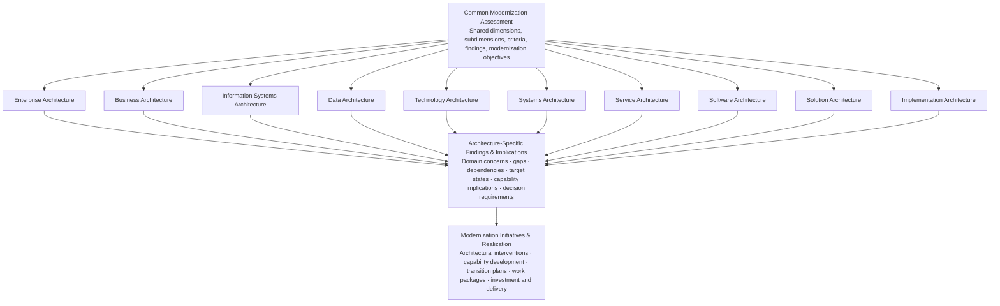

# The Fan-Out Model: Common Assessment to Architecture-Specific Implications

The common framework establishes a modernization assessment independent of architecture type. Architecture-specific contextualization is where the assessment becomes actionable.

## The fan-out

Each domain interprets the common assessment through its own vocabulary, scope, concepts, concerns, criteria, capabilities, and intervention patterns.

## Architecture domain interpretation

| Architecture domain | Modernization contextualization focus |
|---------------------|--------------------------------------|
| Enterprise Architecture | Enterprise direction, operating model, business-technology alignment, organizational structure, investment coherence, enterprise dependencies, transformation |
| Business Architecture | Business capabilities, value streams, business processes, organization, business services, operating model, business performance, value delivery |
| Information Systems Architecture | Information system landscape, system responsibilities, application portfolio, functional boundaries, integration, redundancy, system lifecycle |
| Data Architecture | Data domains, data models, data quality, data ownership, interoperability, governance, lineage, accessibility, lifecycle, data platform architecture |
| Technology Architecture | Infrastructure, platforms, technology stacks, hosting, networks, runtime environments, technical standards, platform lifecycle, engineering constraints |
| Systems Architecture | System boundaries, system composition, behavior, interfaces, dependencies, system qualities, verification, resilience, integration |
| Service-Oriented Architecture | Service boundaries, service contracts, discoverability, composition, interoperability, service governance, reuse, service lifecycle |
| Software Architecture | Software structure, modules, components, dependencies, design patterns, codebase health, software qualities, deployment topology, technical debt |
| Solution Architecture | Solution scope, requirements alignment, solution design, integration, technology choices, constraints, trade-offs, feasibility, architecture decisions |
| Implementation Architecture | Realization mechanisms, implementation patterns, deployment, configuration, environments, automation, execution constraints, implementation fidelity |

## Overlap is explicit, not an exception

The domains are not mutually exclusive. One modernization opportunity may span several domains, and the framework explicitly represents that overlap rather than force a finding into one architecture category.

For instance, modernization of customer onboarding may simultaneously require:

- Business architecture changes to the onboarding value stream.
- Process architecture changes to eliminate manual activities.
- Data architecture changes to unify customer identity and data.
- Information systems architecture changes to retire or replace applications.
- Service architecture changes to expose onboarding functions.
- Software architecture changes to modularize and decouple components.
- Technology architecture changes to support scalable, secure execution.
- Implementation architecture changes to automate deployment and realization.

## One source of truth

The common assessment is the source of truth for the modernization opportunity. Architecture-specific assessments are **linked interpretations and elaborations** of that opportunity, not independently competing assessments.

Full per-domain concern catalogs, vocabulary mappings, evidence sources, and intervention patterns are being built as domain packs per [ROADMAP.md](../../ROADMAP.md) slice S4; see [domain-packs.md](domain-packs.md).
