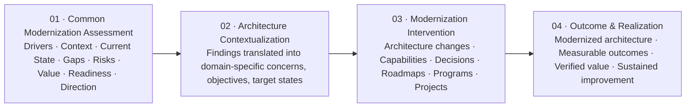

# The Conceptual Model: Common Assessment, Architectural Realization

The framework does not attempt to unify every architecture discipline into a single architecture. It unifies the **assessment of modernization** while preserving the distinct concerns of each architecture.

## The backbone

1. **Common Modernization Assessment.** The eight dimensions (see the [taxonomy](../taxonomy/overview.md)) establish a complete view of why modernization is necessary, what is being modernized, how significant the need is, and what the organization should do about it.
2. **Architecture Contextualization.** Modernization findings are translated into architecture-specific concerns, objectives, and target states (see [contextualization](../contextualization/fan-out-model.md)).
3. **Modernization Intervention.** Architecture changes, capabilities, decisions, roadmaps, programs, and projects (see [realization outputs](../realization/outputs.md)).
4. **Outcome & Realization.** Modernized architecture, measurable outcomes, verified value, sustained improvement.

## Design principles

- **Architecture-agnostic dimensions, architecture-aware interpretation.** The assessment dimensions are universal in intent; their findings are interpreted within a specific architectural context.
- **Common criteria, domain relationships.** The same criterion can be reused across enterprise, business, data, and software architecture; domain applicability is a relationship, not part of the criterion identity (see the [criterion model](../metamodel/criterion-model.md)).
- **One source of truth.** The common assessment is the source of truth for a modernization opportunity. Domain assessments are linked interpretations and elaborations, not independently competing assessments.
- **Traceability.** Every conclusion traces from criterion through evidence, findings, objectives, decisions, initiatives, and outcomes (see the [metamodel](../metamodel/entities.md)).
