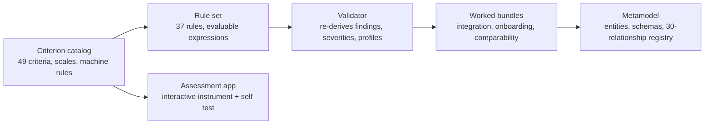

# AMAF: Architecture Modernization Assessment Framework

> One modernization assessment foundation. Multiple architectural interpretations. Coordinated realization.

AMAF is a common, architecture-agnostic framework for assessing architecture modernization: what needs to modernize, why, how significantly, and toward what desired state. The assessment is then contextualized into the specific architecture domains, capabilities, decisions, and interventions required to realize it.

It lives in the [Assessment-Models organisation](https://github.com/Assessment-Models) alongside the governed Architecture Modernization Maturity Model. The two are deliberately distinct: AMAF assesses the **modernization need of architectures**; the maturity model assesses the **maturity of the modernization practice**. Under AMAF, maturity is an input, not the organizing principle (see [Maturity vs Modernization](realization/maturity-vs-modernization.md) and the [maturity bridge](methodology/maturity-bridge.md)).

## The two assessment concerns

| Concern | Question answered |
|---------|-------------------|
| Common modernization assessment | What needs to modernize, why, how significantly, and toward what desired state? |
| Architecture-specific contextualization | What does that modernization opportunity mean for each affected architecture? |

The separation makes modernization opportunities comparable across disciplines without erasing the technical and contextual differences between them.

## Where to start

| If you want to... | Start with |
|-------------------|------------|
| Understand the problem and the thesis | [The Problem](framework/01-the-problem.md) and the [Conceptual Model](framework/02-conceptual-model.md) |
| See the assessment space | The [taxonomy overview](taxonomy/overview.md) and dimensions D1 through D8 |
| Run an assessment | The [evidence model](methodology/evidence-model.md), the [interpretation logic](methodology/interpretation-logic.md), and the [assessment app](https://github.com/Assessment-Models/maturity-model-modernization/blob/main/tools/assessment-app/README.md) |
| See what an assessment produces | The [assessment outputs](realization/outputs.md) and the [worked examples](examples/integration-architecture.md) |
| Check the machine layer | The [metamodel section below](#the-machine-layer) |
| Verify the claims | The [validation notes](validation/validation-notes.md) and the [coverage argument](validation/coverage-argument.md) |

## What is machine-checked

The framework is not prose with aspirations. Its rules are evaluable, and the machinery runs:

- **Criterion catalog**: 49 fully modeled criteria with scales, applicability rules, and machine rules ([`tools/criterion-catalog/`](https://github.com/Assessment-Models/maturity-model-modernization/blob/main/tools/criterion-catalog/criteria-catalog.yaml), normative v0.4.1).
- **Machine rule set**: 37 rules with parameters and evaluable expressions ([`framework/rules/amaf-rules.yaml`](https://github.com/Assessment-Models/maturity-model-modernization/blob/main/framework/rules/amaf-rules.yaml)), mirroring the catalog's assessment and interpretation rules.
- **Validator**: [`framework/validate.py`](https://github.com/Assessment-Models/maturity-model-modernization/blob/main/framework/validate.py) re-derives every finding class, severity, confidence effect, opportunity synthesis, and profile from three worked bundles, and fails on any violation.
- **Self-testing instrument**: the [assessment app](https://github.com/Assessment-Models/maturity-model-modernization/blob/main/tools/assessment-app/selftest.js) runs a behavioral probe suite against the same catalog export.
- **Worked examples**: the [integration assessment](examples/integration-architecture.md), the [customer onboarding example](examples/customer-onboarding.md), and the [inter-rater comparability study](examples/inter-rater-comparability.md), all machine-validated end to end.

## The machine layer

The formal artifacts (metamodel, JSON Schemas, machine rules, example bundles) are documented in the [metamodel](metamodel/entities.md) section, with the review and versioning policy in [Governance](governance/versioning.md).

## Status

The framework is content-complete and validated: the [ROADMAP](https://github.com/Assessment-Models/maturity-model-modernization/blob/main/ROADMAP.md) slices covering the taxonomy, assessment mechanics, interpretation and prioritization logic, domain packs, the assessment instrument, the metamodel, validation with worked examples, and this site are done. Machine validation, not assertion, is the acceptance bar throughout: see the [validation notes](validation/validation-notes.md).

This site is built with a strict configuration and published from the repository's `main` branch on every docs-touching push by the [deployment workflow](https://github.com/Assessment-Models/maturity-model-modernization/blob/main/.github/workflows/docs.yml).
