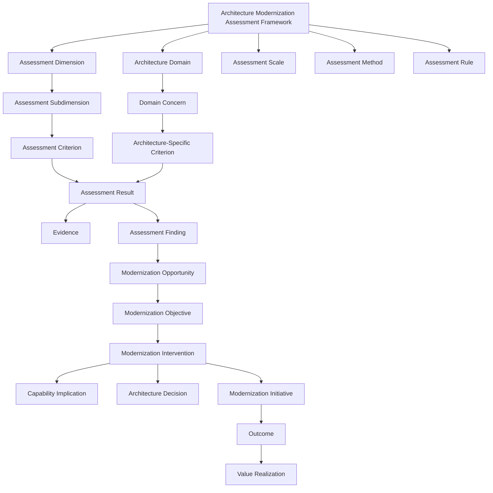

# Metamodel Structure and Relationships

## Framework structure

## Relationships and cardinality

The model supports the following:

- A framework contains multiple dimensions.
- A dimension contains multiple subdimensions.
- A subdimension contains multiple criteria.
- A criterion can be applicable to multiple architecture domains.
- An architecture domain can have multiple domain-specific concerns.
- A criterion may have different assessment methods depending on its context.
- An assessment evaluates multiple subjects.
- Each subject can receive multiple criterion assessment results.
- Each assessment result can be supported by multiple evidence records.
- A finding can be derived from multiple results and evidence records.
- A modernization opportunity can be informed by multiple findings.
- A modernization opportunity can span multiple architecture domains.
- A modernization opportunity can have multiple objectives and target states.
- An intervention may address multiple findings and opportunities.
- An intervention can require, introduce, improve, transform, or retire capabilities.
- An intervention may produce multiple architecture decisions and initiatives.
- An initiative may realize multiple outcomes.
- Outcomes can be associated with measurable value realization.

## Traceability

The structure preserves traceability from the assessment criterion through evidence, findings, modernization objectives, architecture decisions, initiatives, and outcomes. Formal cardinality constraints and model artifacts for OpenDEA are being produced per [ROADMAP.md](https://github.com/Assessment-Models/maturity-model-modernization/blob/main/ROADMAP.md) slice S6.
