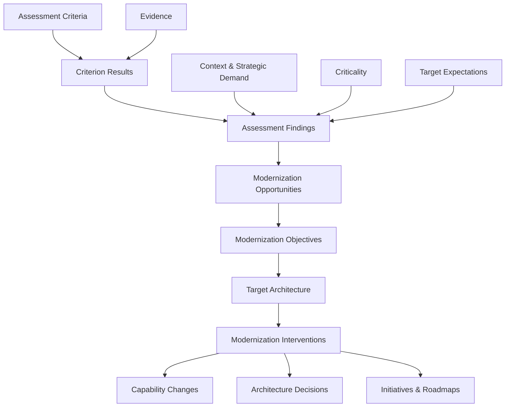

# Interpretation Logic: From Criteria to Modernization Opportunities

The framework does not simply produce an assessment score. It produces a reasoned modernization interpretation. A modernization opportunity emerges through the combination of assessment results, evidence, context, strategic demand, criticality, risk, and target-state expectations.

## The interpretation flow

## Stages of interpretation

1. **Criterion results**: scored, evidenced, with confidence and criticality.
2. **Findings**: interpreted observations arising from results and evidence, read in context. A finding is an interpreted statement, not a raw score.
3. **Modernization opportunities**: recognized opportunities or needs for architectural change, informed by multiple findings. One opportunity typically draws on findings across several dimensions.
4. **Objectives and target states**: the outcome or change objective associated with the opportunity.
5. **Interventions and initiatives**: the architectural or organizational response, producing capability changes, architecture decisions, initiatives, and roadmaps.

## Worked example

The full integration architecture worked example lives in [`docs/examples/integration-architecture.md`](../examples/integration-architecture.md). It shows how eight assessment concerns combine into one modernization opportunity that fans out into nine architecture-specific implications.

Finding derivation rules (which result and evidence combinations constitute a finding, and finding severity semantics) and opportunity synthesis rules are being formalized per [ROADMAP.md](../../ROADMAP.md) slice S3.
