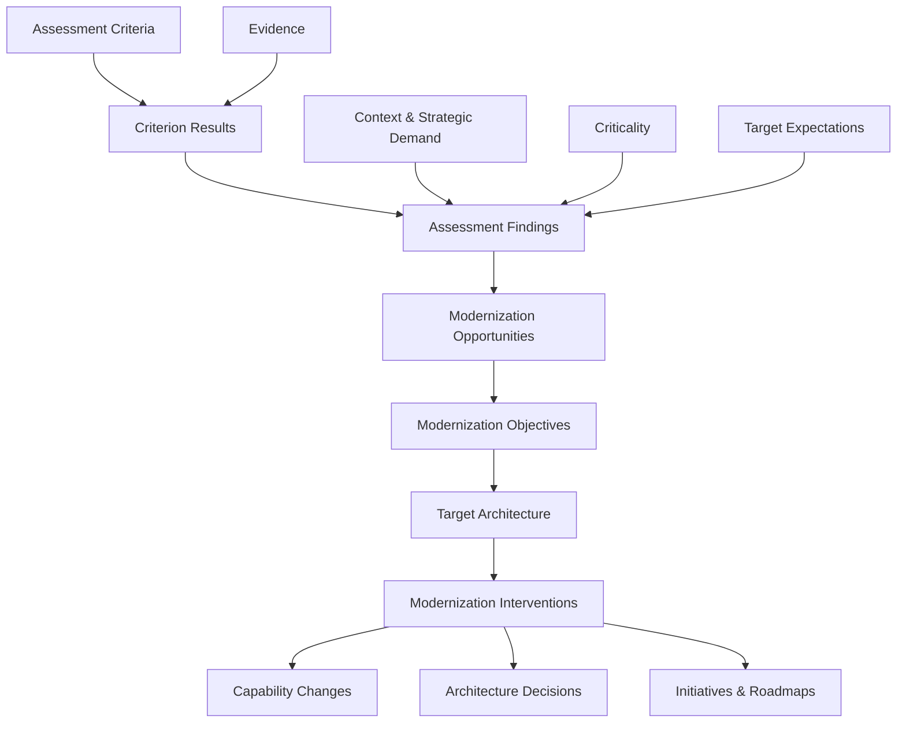

# Interpretation Logic: From Criteria to Modernization Opportunities

The framework does not simply produce an assessment score. It produces a reasoned modernization interpretation. A modernization opportunity emerges through the combination of assessment results, evidence, context, strategic demand, criticality, risk, and target-state expectations.

*This page is normative: the rules below state which results and evidence combinations constitute findings, how finding severity is derived, and how findings combine into opportunities. The machine-readable form is the `interpretation_rules` section of the [criterion catalog](https://github.com/Assessment-Models/maturity-model-modernization/blob/main/tools/criterion-catalog/criteria-catalog.yaml). Recording templates are in [output templates](../realization/output-templates.md).*

## The interpretation flow

## Stages of interpretation

1. **Criterion results**: scored, evidenced, with confidence and criticality, per the [scoring](scoring-mechanics.md) and [evidence mechanics](evidence-mechanics.md).
2. **Findings**: interpreted observations arising from results and evidence, read in context. A finding is an interpreted statement, not a raw score, and it is derived by rule (below).
3. **Modernization opportunities**: recognized opportunities or needs for architectural change, synthesized from findings by rule. One opportunity typically draws on findings across several dimensions.
4. **Objectives and target states**: the outcome or change objective associated with the opportunity.
5. **Interventions and initiatives**: the architectural or organizational response, producing capability changes, architecture decisions, initiatives, and roadmaps.

## Finding derivation rules

A finding is the atomic interpreted output of the assessment. Not every result warrants one, and no finding exists without its basis.

**R-I1 Basis and provenance.** A finding derives from one or more recorded criterion results and their evidence. Every finding states the criterion result identifiers and evidence items it draws on. A finding that cannot cite its basis is an assertion, not a finding (the traceability requirement of [assessment outputs](../realization/outputs.md) applies here first).

**R-I2 Confidence floor.** Only results at medium confidence or higher inform findings, per the findings floor in the `assessment_rules` of the catalog. A low-confidence result is carried as an **unverified observation**: it may direct further evidence gathering, but it can never found a finding on its own, and a finding composed entirely of low-confidence results cannot be issued.

**R-I3 Finding classes.** Any of the following combinations constitutes a finding candidate; the class is derived from the result, not chosen by the assessor:

| Class | Derivation | Reads as |
|-------|------------|----------|
| Deficiency | Applicable condition (or target) result at score 2 or below | The subject has a below-adequacy weakness on the proposition |
| Exposure | Applicable exposure result at score 2 or below | Risk is not adequately known, or sits outside stated tolerance |
| Demand | Applicable demand result at score 2 or below against recorded anticipated demand | Recorded future duties exceed demonstrated capacity |
| Constraint | Applicable changeability or readiness result at score 2 or below | The path to change is limited; this constrains *how*, not *whether* |
| Strength | Applicable result at score 4 or above with high confidence | An asset to build on; recorded, never an action item |

**R-I4 Corroboration carry-over.** Sufficiency rules from the [evidence mechanics](evidence-mechanics.md) carry into interpretation: an extreme result (score 1 or 5) without the required corroboration is capped at medium confidence and may not be the sole basis of a finding.

**R-I5 What is not a finding.** Inapplicable, deferred, and out-of-scope criteria are recorded decisions with reasons (applicability is decided first, per the [aggregation mechanics](aggregation-mechanics.md)); they generate no findings. Results at score 3 with no set target generate no finding: adequacy with no expressed ambition is not a deficiency.

**R-I6 Overshoot.** An overshoot of two or more is a target-rationality signal, not an action trigger: it produces a deliberate-excess review note (per gap semantics in the [aggregation mechanics](aggregation-mechanics.md)), and if the review sustains the overshoot, a constraint finding against the target rationale.

**R-I7 Composition.** One finding may draw on multiple results when they describe the same observed condition; the interpretation must remain faithful to each basis result (a finding may not claim more than its basis says). Several results that merely share a dimension are not thereby one finding.

## Finding severity semantics

Severity communicates the import of a finding to the modernization case. It is a derived classification, never an intuition, and it is never added, averaged, or converted back into a score.

The ordered severity scale is **minor, moderate, material, severe**. A finding's severity is the first row satisfied, evaluated against its basis results:

| Severity | Derivation (any one satisfied) |
|----------|-------------------------------|
| Severe | A basis result at score 1; or a positive gap of 3 or more; or an exposure finding whose risk sits outside stated tolerance on a subject region carrying high or critical criticality |
| Material | A basis result at score 2 with high or critical criticality overlay; or a demand finding against demand the organization has committed to; or a positive gap of 2 on a below-adequacy result |
| Moderate | A basis result at score 2 without further escalation; or a positive gap of 2 on a result otherwise adequate today |
| Minor | Any other qualifying finding, such as an adequate result (score 3) with a set target above it |

Rules of composition:

- A multi-result finding takes the **highest severity** among its basis results, and reports the severity distribution alongside. Severity is never averaged across results, for the same reason confidence is not ([aggregation mechanics](aggregation-mechanics.md)).
- Strength findings carry no severity; they are assets, recorded separately from deficiency, exposure, demand, and constraint findings.
- Constraint findings may escalate the *path* discussion (they feed the preparatory pattern in [prioritization](prioritization.md)) but never inflate the need itself.

## Opportunity synthesis rules

A modernization opportunity is a course of architectural change inferred from findings. Synthesis is rule-governed, not creative clustering.

**R-O1 Combination test.** Findings combine into one opportunity when a single course of change would close their target gaps together: they concern the same subject region, and the same intervening elements (capabilities, components, contracts, decisions). Findings that merely sit in the same dimension do not combine; dimension adjacency is convenience, not a change theme.

**R-O2 No dimensional convenience.** Opportunities span dimensions; dimensions are lenses, not work partitions. Merging findings by dimension, or splitting an opportunity to mirror the taxonomy, both violate the fan-out model ([contextualization](../contextualization/fan-out-model.md)).

**R-O3 Required content.** Every opportunity records: its change theme and statement; the finding identifiers it draws on (and through them, results and evidence); the dimensions it draws on; the gap profile it intends to close; the target position it moves toward (from target-state criteria, D8); the option set considered; and its significance characterization per the factor anchors in [prioritization](prioritization.md). Significance is characterized per factor, never compressed to a number.

**R-O4 Strengths inform, never found.** Strength findings shape the option set, feasibility, and target rationale of an opportunity. An opportunity resting solely on strengths (nothing to close, nothing at risk, no unmet demand) is not created.

**R-O5 No finding parked silently.** Every severe or material finding is either drawn into an opportunity or explicitly parked with a recorded reason (accepted risk, deferred decision, re-scope). Findings may not be dropped silently; low-basis opportunities are deferred pending evidence, not discarded.

## Worked example: from results to one opportunity

Integration architecture example (full story in [the worked example](../examples/integration-architecture.md)); types and target scores per the [assessment scales](assessment-scales.md):

| Result | Criterion | Type | Score | Target | Gap | Criticality overlay |
|--------|-----------|------|-------|--------|-----|---------------------|
| RES-01 | D5.4.1 Fragmentation and redundancy | condition | 1 | 4 | 3 | high |
| RES-02 | D3.2.1 Representation fidelity | condition | 1 | 3 | 2 | high |
| RES-03 | D5.2.1 Independence of change | changeability | 2 | 4 | 2 | high |
| RES-04 | D6.3.1 Operational risk exposure | exposure | 2 | 3 | 1 | high |
| RES-05 | D4.4.1 Integration capability | demand | 2 | 3 | 1 | high |
| RES-06 | D7.4.1 Delivery capacity | readiness | 2 | 4 | 2 | medium |
| RES-07 | D8.1.1 Target state definition | target | 4 | 4 | 0 | medium |

Derived findings (per R-I3, severities per the table above):

| Finding | Class | Severity | Basis | Statement |
|---------|-------|----------|-------|-----------|
| F-1 | Deficiency | Severe | RES-01 | Integration logic is fragmented and duplicated across mechanisms (gap 3) |
| F-2 | Deficiency | Severe | RES-02 | The integration baseline is not reliably represented; interfaces are largely undocumented |
| F-3 | Constraint | Material | RES-03 | Coupling across mechanisms prevents independent change at tolerable effort |
| F-4 | Exposure | Severe | RES-04 | Fragile integration dependencies sit outside stated tolerance on a high-criticality region |
| F-5 | Demand | Material | RES-05 | Recorded partner growth and real-time interaction demand exceed current integration capacity |
| F-6 | Constraint | Moderate | RES-06 | Delivery capacity for integration change is limited, chiefly by absent automated testing |
| F-7 | Strength | (none) | RES-07 | The target position (standardized, discoverable, independently manageable integration services) is clearly defined |

Synthesis per R-O1: F-1 through F-5 concern one subject region and one course of change (establishing standardized, discoverable, independently manageable integration services closes the fragmentation, baseline, coupling, risk, and capacity gaps together). They form **O-1: Integration service standardization**. F-6 does not join the theme: it constrains the how, and becomes the basis of a preparatory initiative under the [prioritization](prioritization.md) readiness pattern. F-7 grounds O-1's target position and option set.

O-1 is recorded with finding identifiers F-1..F-5, asset F-7 and constraint F-6, dimensions drawn (D2, D3, D4, D5, D6, D8), the gap profile it closes (targets of RES-01, RES-02, RES-03, RES-04, RES-05), and its target position from RES-07. Its prioritization, dependency edges, and staged path continue in [prioritization](prioritization.md).
